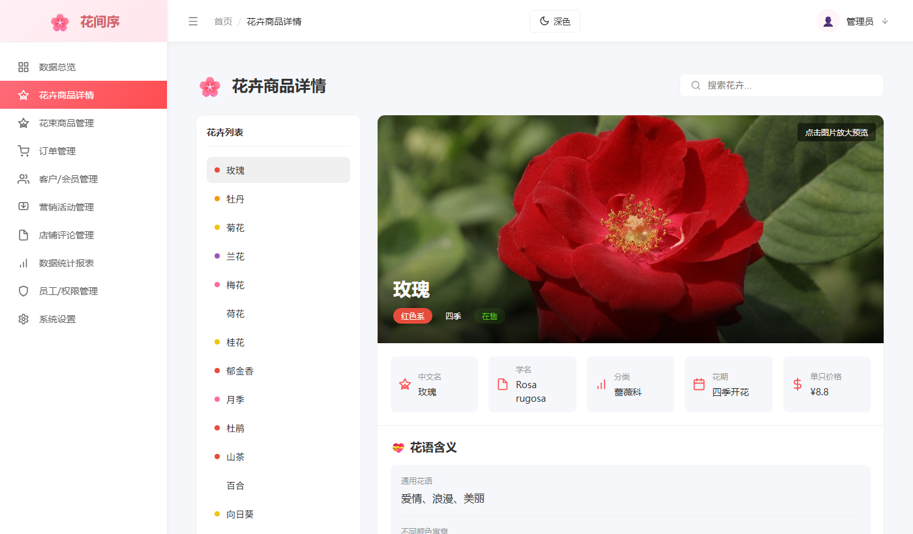
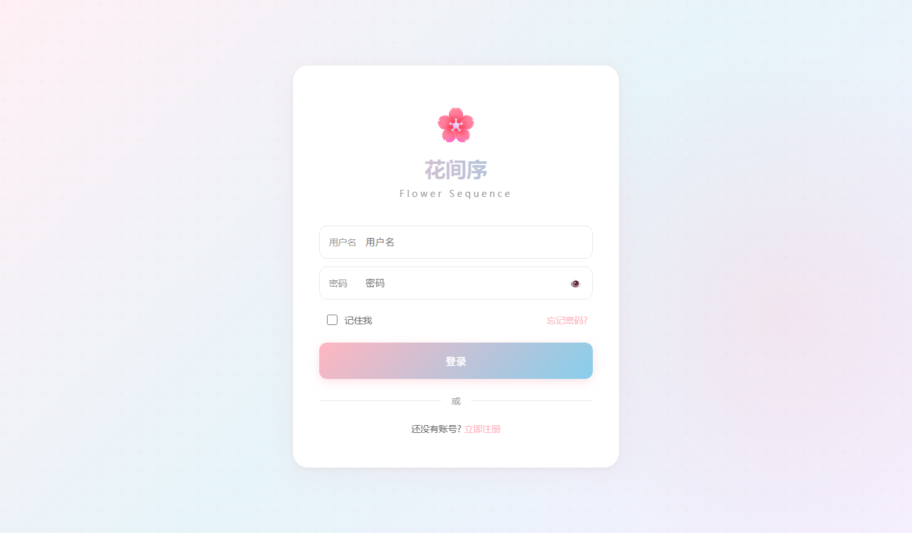
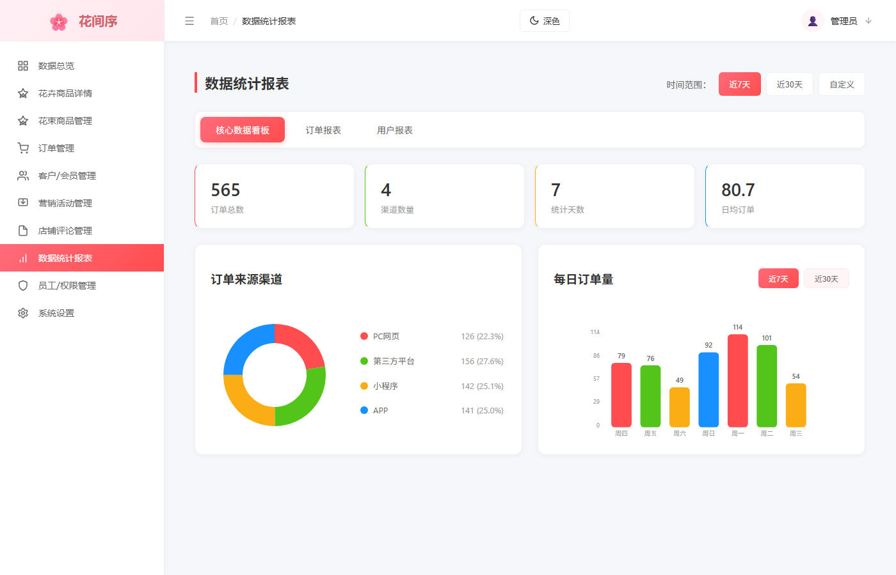

# 花间序 · 花卉主题社区与后台管理系统

一个以花卉为主题的社区平台，包含 **用户端** 与 **后台管理** 两部分，共 30 个页面。
使用 React 19 开发，纯前端项目，数据层通过 `localStorage` 模拟。

## 界面预览

**花卉商品详情**（侧栏可切换 20 种花卉，含花语、花期、生长习性与花卉故事）



**我的收藏**（卡片式展示，支持分类筛选）



**数据统计报表**（环形图与柱状图均由原生 SVG 绘制，未引入任何第三方图表库）



---

## 技术栈

| 分类 | 技术 |
| --- | --- |
| 框架 | React 19 |
| 路由 | React Router 7（`createBrowserRouter`） |
| 状态管理 | React Context + Hooks（`useMemo` / `useEffect`） |
| 样式 | 原生 CSS + 设计 token（深浅两套主题） |
| 构建 | Create React App |
| 图表 | 手写 SVG（无第三方图表库） |

## 功能模块

### 用户端（19 个页面）
- 首页、花卉首页、花卉详情、花语故事
- 花园、社区、帖子详情
- 成就、我的收藏
- 花卉匹配、相似花卉推荐
- 季节分类、色彩分类
- 工具、教程
- 登录、注册、欢迎页

### 后台管理（10 个模块）
- 花卉管理、用户管理、客户/会员管理
- 订单管理、营销管理、员工管理
- 内容审核、评论管理
- 数据报表、系统设置

## 技术亮点

1. **路由守卫**：封装 `RequireAuth` 组件，统一处理登录态与角色校验。
   未登录访问后台会跳转登录页并记录来源路径，登录成功后自动回跳；
   非管理员访问后台重定向首页。
2. **主题系统**：基于 Context + `useMemo` 注入深浅两套设计 token
   （颜色、阴影、表格样式等），主题选择持久化到 `localStorage`，切换实时生效。
3. **数据可视化**：后台数据报表使用手写 SVG 绘制环形图与折线图，
   不依赖第三方图表库，支持按时间维度切换。
4. **数据层封装**：`src/data` 下统一封装 users / flowers 数据模块，
   基于 `localStorage` 模拟增删改查，统一登录 token 与角色字段。

## 目录结构

```
src/
├── components/     通用组件（布局、详情面板、路由守卫等）
├── context/        主题 Context
├── data/           数据层（users、flowers）
├── pages/          页面（19 个用户端 + 10 个后台）
├── router/         路由配置
├── App.js
└── index.js
```

## 本地运行

```bash
# 安装依赖
npm install

# 启动开发服务器，访问 http://localhost:3000
npm start

# 打包
npm run build
```

## 测试账号

| 角色 | 账号 | 密码 |
| --- | --- | --- |
| 管理员 | admin | admin123 |
| 普通用户 | user | user123 |

> 说明：本项目为纯前端演示项目，数据保存在浏览器 `localStorage` 中，
> 未接入真实后端接口。
